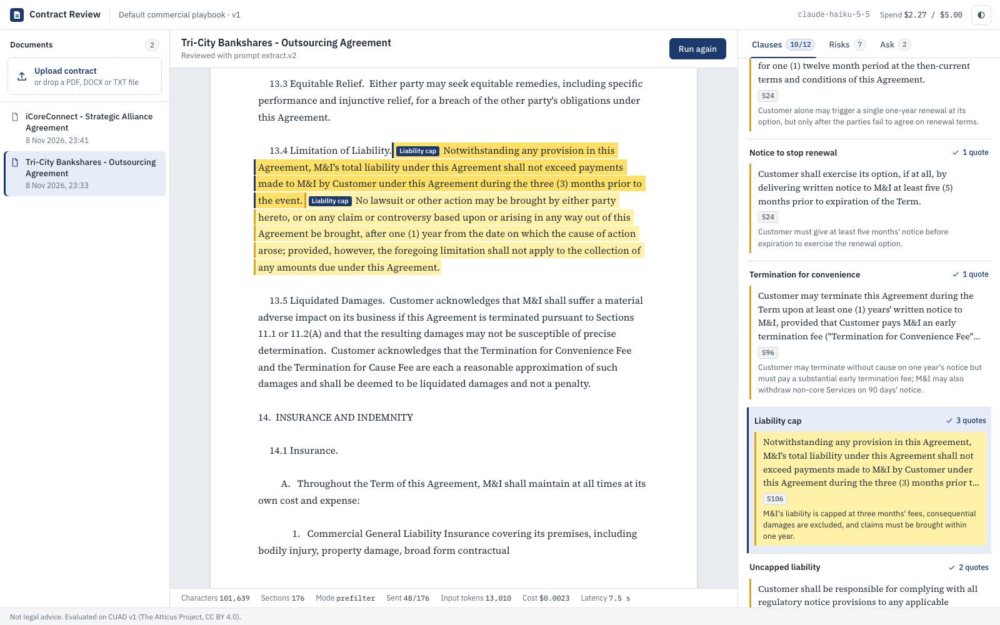

# contract-review-ai

[](https://github.com/bprakashputta/contract-review-ai/actions/workflows/ci.yml)

**Upload a contract and get its key clauses, each with the exact text, checked against the document by code.**

A FastAPI service with a small web UI for legal and ops teams. It reads a PDF, DOCX or TXT contract and finds 12 clause types (governing law, auto-renewal, notice to stop renewal, termination for convenience, liability cap, uncapped liability, non-compete, exclusivity, IP assignment, change of control, anti-assignment, audit rights). It quotes the text for each one, flags risks against a YAML playbook and answers questions with citations.

The rule throughout: **the model quotes, code checks.** Every quote is matched against the document before it is shown. A quote that can't be found is dropped. Risk flags come from deterministic rules applied to verified clauses only.



- **12 CUAD clause categories**, one Claude Haiku 5.5 call per contract, JSON-schema structured output
- **Quote verification in code:** normalized matching mapped back to exact character offsets, plus repair for page footers that split a sentence. Only verbatim document text is highlighted
- **Cost-aware long-document handling:** a BM25 + keyword prefilter sends the 45% of a contract that matters. Input tokens fall 44% and quality holds (see eval)
- **YAML playbook:** required/forbidden clauses, a minimum non-renewal notice in days, allowed jurisdictions. Numbers are parsed from the verified quote by code, not taken from the model
- **Cited Q&A:** retrieval over sections, answers with quotes, unverifiable citations dropped, and an answer with no verified citation marked unsupported
- **Production basics:** hard spend cap enforced by a ledger before every call, response cache (identical calls cost $0), retries and timeouts, per-call token/cost/latency JSON logs, `/healthz` + `/readyz`, one-command Docker

## Architecture

```
 browser (vanilla JS UI)            curl / any client
        │  upload · review · ask         │
        ▼                                ▼
 ┌──────────────────────────── FastAPI (api.py) ──────────────────────────────┐
 │                                                                             │
 │  parse (pypdf / python-docx) ─► sections with char offsets ─► SQLite store  │
 │                                                                             │
 │  LangGraph review pipeline (pipeline.py)                                    │
 │    parse ─► route ──(≥3K tokens)──► prefilter ─► extract ─► verify ─►       │
 │               └─────(short doc)──────────────────┘          playbook ─► report
 │                                                                             │
 │  LangGraph Q&A (qa.py)   retrieve (BM25 + query expansion) ─► answer ─► verify
 │                                                                             │
 │  llm.py: spend ledger check ─► response cache ─► Anthropic Messages API     │
 │          (JSON-schema output, retries, timeout, usage → cost → JSON log)    │
 └─────────────────────────────────────────────────────────────────────────────┘
        data/ volume: contracts.db · llm_cache.sqlite · spend.jsonl
```

| Module | Role |
|---|---|
| `parsing.py` | PDF/DOCX/TXT → text → sections (`[start, end)` offsets, ≤1.8K chars) |
| `prefilter.py` | BM25 + keyword scoring per category; top-k union of sections |
| `extract.py` | prompt rendering (`prompts/extract.v2.yaml`), the call, quote verification per clause |
| `verify.py` | normalized matching with an offset map; `exact` / `repaired` / `unverified` |
| `playbook.py` | rule engine over verified clauses (`playbooks/default.yaml`) |
| `qa.py` | retrieval, cited answer, citation verification |
| `llm.py` | the only module that calls Claude: ledger, cache, pricing, logging |
| `evaluation/` | CUAD loader, metrics, eval runners, report builder |

## Quick start

### Docker

```bash
git clone https://github.com/bprakashputta/contract-review-ai && cd contract-review-ai
cp .env.example .env              # add ANTHROPIC_API_KEY; SPEND_CAP_USD defaults to 5.00
docker compose up --build         # http://localhost:8000
```

### Local

```bash
uv sync
uv run contract-review-ai         # http://localhost:8000
uv run pytest -q                  # 35 tests, offline (the LLM is faked)
```

### API

```bash
curl -F file=@contract.pdf localhost:8000/api/documents            # -> {"id": "...", "sections": 176, ...}
curl -X POST localhost:8000/api/documents/<id>/review              # clauses, quotes, offsets, risk flags, cost
curl -X POST localhost:8000/api/documents/<id>/ask \
     -H 'content-type: application/json' -d '{"question": "Can either party terminate without cause?"}'
```

A clause in the review response:

```json
{"category": "notice_to_terminate_renewal", "found": true,
 "quotes": [{"text": "Customer shall exercise its option, if at all, by delivering written notice to M&I at least five (5) months prior to expiration of the Term.",
             "status": "exact", "start": 13260, "end": 13400, "section_id": "S24"}],
 "dropped_quotes": [], "model_said_found": true}
```

## Evaluation

**Dataset:** [CUAD v1](https://www.atticusprojectai.org/cuad) (The Atticus Project, CC BY 4.0): 510 commercial contracts with lawyer-annotated clause spans. I use the authors' official split. The 408 **train** contracts were the dev set: prefilter tuning, prompt iteration, verifier fixes. Results below are on the 102 **test** contracts, which were not used for tuning. `make data` downloads the split into the gitignored `data/` directory.

**Metrics,** per contract × category (12 × 102 = 1,224 decisions):
- *Presence* precision, recall and F1: the clause is predicted present when at least one verified quote exists, and gold-present when CUAD has at least one span.
- *Span hit:* among true positives, the share where a quote overlaps a gold span.
- *Mean Jaccard:* character overlap between the predicted quotes and the gold spans.

**Reproduce:** `make eval` (final pipeline) or `make eval-all` (every row below). Results are committed in [`evals/results/`](evals/results/), with per-category tables in [`RESULTS.md`](evals/results/RESULTS.md).

### Clause extraction, CUAD test (N = 102 contracts, Claude Haiku 5.5)

| configuration | micro P | micro R | micro F1 | macro F1 | span hit | Jaccard | $/contract | p50 latency |
|---|---|---|---|---|---|---|---|---|
| naive: whole contract, category names only | 0.751 | 0.906 | 0.821 | 0.780 | 0.959 | 0.655 | $0.00228 | 5.1 s |
| whole contract, definitions + quoting rules (`extract.v2`) | 0.845 | 0.937 | 0.889 | 0.858 | 0.970 | 0.692 | $0.00272 | 3.8 s |
| **final: prefilter + `extract.v2` + verification** | **0.848** | **0.944** | **0.893** | **0.862** | 0.968 | 0.702 | **$0.00151** | 3.6 s |

Paired bootstrap over contracts (5,000 resamples), micro-F1:

| comparison | Δ | 95% CI |
|---|---|---|
| final vs naive | +0.072 | [+0.049, +0.096] |
| final vs whole contract with the same prompt | +0.005 | [−0.013, +0.022] |
| Sonnet 5.5 vs Haiku 5.5 (same 40 contracts, final pipeline) | +0.001 | [−0.024, +0.025] |

What this shows:
- **The prompt drives quality.** CUAD definitions plus boundary notes ("an indemnity is not uncapped liability", "keeping your own IP is not an assignment") account for the +0.07 F1. I wrote the notes from dev-split errors, where micro-F1 went from 0.865 (v1) to 0.882 (v2) on 60 contracts.
- **The prefilter cuts cost at no measurable quality cost.** 81 of 102 contracts were prefiltered. Mean input tokens fell from 17,881 to 10,060, and the most expensive contract fell from $0.054 to $0.004, because whole-contract requests over 100K tokens hit Haiku's long-context price.
- **Sonnet 5.5 is not worth 19.6× the cost here:** micro-F1 0.902 vs 0.901, $0.029 vs $0.0015 per contract.

### What quote verification catches

| | quotes returned | unverified (dropped) | repaired to document text |
|---|---|---|---|
| naive | 645 | 4 | 23 |
| final | 599 | 2 | 11 |
| final, exact-match-only verifier (ablation) | 599 | 13 | – |

Haiku 5.5 with structured output rarely invents a quote: 2 of 599, or 0.3%. The ones it did invent look plausible. In one, the model finished a sentence the PDF extraction cut off ("which consent shall" became "…shall not be unreasonably withheld."). In another, it joined clauses 7.1 and 7.1.3 into one quote. The harder problem was the opposite: **real quotes broken by page footers.** An exact-only verifier drops 13 quotes and loses 6 true-positive clauses (F1 0.888). The repair step matches up to 4 in-order fragments and keeps those clauses. The quote shown is still the document's own text.

### Cited Q&A, CUAD test (30 contracts, 113 questions)

Each category becomes a plain question ("Can either party terminate without cause, just by giving notice?"). Each contract gets 2 questions whose clause is present and 2 whose clause is absent.

| retrieval | answers iff clause exists | present → answered | present → verified citation overlaps gold | absent → abstained | unverified citations |
|---|---|---|---|---|---|
| BM25 on the question | 0.832 | 0.782 | 0.764 | 0.879 | 0/94 |
| **BM25 + category query expansion** | **0.841** | **0.836** | **0.800** | 0.845 | 0/102 |

The first test run used plain BM25. A diagnosis of its misses showed that 10 of the 12 unanswered present-clause questions came from retrieval: the gold clause was not in the top 6 sections. The model was not the cause. I then built query expansion and compared both variants on 30 dev contracts (present-clause hit rate 0.765 → 0.863) before running test again. Both test runs are reported. Expanding a question that names a clause type ("renewing", "liability") with that category's vocabulary raised present-clause recall. It also lowered abstention, because more loosely related text now reaches the model. Cost: $0.0003 per question, p50 1.2 s.

**Total API spend for the whole project** (development, all eval runs, demo): **$2.27** of the $5.00 cap, from `data/spend.jsonl`.

## Design decisions

ADRs in [`docs/decisions/`](docs/decisions/):
1. [Code verifies every quote; rules decide risk](docs/decisions/001-code-verifies-every-quote.md)
2. [LangGraph for orchestration, the Anthropic SDK for model calls](docs/decisions/002-raw-sdk-inside-langgraph.md)
3. [Lexical prefilter, no embeddings](docs/decisions/003-lexical-prefilter.md)
4. [SQLite](docs/decisions/004-sqlite.md)
5. [Haiku 5.5 default, Sonnet 5.5 measured](docs/decisions/005-haiku-default-sonnet-compared.md)

Prompts are versioned files in [`prompts/`](prompts/). Every review records which prompt version produced it.

## Limitations

- **Weak categories.** Uncapped liability (P 0.59), IP assignment (P 0.64) and non-compete (P 0.64) over-trigger. The model still flags some plain indemnities and "each party keeps its IP" clauses. CUAD's own labels are also inconsistent on these boundaries.
- **Span boundaries differ from CUAD's.** Mean Jaccard is 0.70. The model often quotes one sentence where annotators highlighted several, or the reverse. Presence detection is much stronger than exact span agreement.
- **Q&A over-answers when the clause is absent** (abstains 85%). A few of these look like CUAD annotation gaps, but not all.
- **Text-only PDFs.** Scanned PDFs need OCR first. The API rejects documents with no extractable text.
- **English US/UK commercial contracts.** CUAD is SEC-filed agreements. The prefilter keywords and the jurisdiction list assume that domain.
- **Not legal advice.** This is a first-pass review aid. The playbook encodes an example policy, not a recommendation.
- **Single tenant.** No authentication. SQLite allows one writer process.

## Credits

CUAD v1 by The Atticus Project, licensed under [CC BY 4.0](https://creativecommons.org/licenses/by/4.0/). It is downloaded by script and not redistributed here. The UI screenshot shows a contract from the CUAD test split.

MIT licensed.
